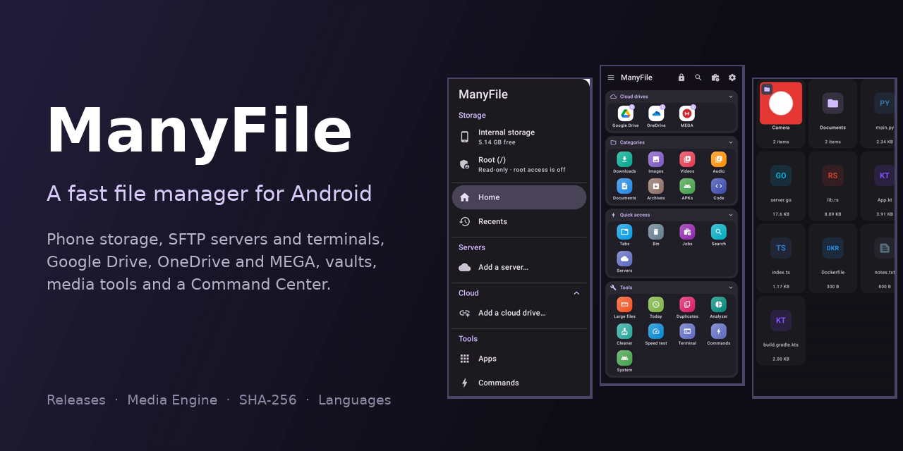

<div align="center">

# 

[](https://t.me/TheCarlTech)
[](https://t-ct.org/s/wa)
[](https://t-ct.org/donate/)

<p><strong>A Fast WA Bot Powered by Rust</strong></p>

</div>

---

<div align="center">

##  Latest Release

Grab the newest version from the <a href="https://github.com/i-tct/tct/releases/latest">GitHub Releases</a>.

</div>

---

<div align="center">

## About

**TCT** is a powerful and fast WA bot manager designed for both personal and group administration.

It provides full control over your WhatsApp automation with:

 High-performance **Rust engine**  
 **Multi-language support**  
 **Advanced group management**  
 Easy set usage **view dashboard**

## Dashboard Preview

<p>
  
  
  
</p>

<p>
  <a href="https://youtu.be/XxxZQ-Jd5ac">Watch how to set up the Dashboard</a>
</p>

</div>

---

<div align="center">

## Supported Languages

<table>
  <tr>
    <th>Language</th>
    <th>Code</th>
    <th>Command</th>
  </tr>
  <tr>
    <td>Arabic</td>
    <td><code>ar</code></td>
    <td><code>.lang ar</code></td>
  </tr>
  <tr>
    <td>English</td>
    <td><code>en</code></td>
    <td><code>.lang en</code></td>
  </tr>
  <tr>
    <td>Spanish</td>
    <td><code>es</code></td>
    <td><code>.lang es</code></td>
  </tr>
  <tr>
    <td>French</td>
    <td><code>fr</code></td>
    <td><code>.lang fr</code></td>
  </tr>
  <tr>
    <td>Hindi</td>
    <td><code>hi</code></td>
    <td><code>.lang hi</code></td>
  </tr>
  <tr>
    <td>Portuguese</td>
    <td><code>pt</code></td>
    <td><code>.lang pt</code></td>
  </tr>
  <tr>
    <td>Russian</td>
    <td><code>ru</code></td>
    <td><code>.lang ru</code></td>
  </tr>
  <tr>
    <td>Indonesian</td>
    <td><code>id</code></td>
    <td><code>.lang id</code></td>
  </tr>
  <tr>
    <td>Swahili</td>
    <td><code>sw</code></td>
    <td><code>.lang sw</code></td>
  </tr>
</table>

<p>Change the bot language using:</p>

<pre><code>.lang &lt;language&gt;</code></pre>

<p>Example:</p>

<pre><code>.lang sw</code></pre>

</div>

---

<div align="center">

## Quick Start

### 1 Generate Your Session

Before deploying, link your WA account.

<a href="https://t-ct.org/pair/qr">
  
</a>

</div>

---

<div align="center">

## Deployment Options

### Linux / Debian / Ubuntu / VPS

<pre><code>bash &lt;(curl -sL https://t-ct.org/dl/vps)</code></pre>

<a href="https://t-ct.org/vps/">VPS Guide</a>

#### TCT Process Manager

For Debian and Ubuntu VPS installations:

<a href="https://t-ct.org/docs/tct-pm">TCT Process Manager Documentation</a>

---

### Windows

Run in <strong>PowerShell (Admin)</strong>

<pre><code>irm https://t-ct.org/dl/windows | iex</code></pre>

<a href="https://t-ct.org/windows/">Windows Guide</a>

---

### TCTApp

<a href="https://play.google.com/store/apps/details?id=com.tct.bot">Get TCTApp on Google Play</a>

---

### Deploy on Heroku

<a href="https://t-ct.org/heroku/">Deploy to Heroku</a>

 Edit the <code>formation</code> section in <code>app.json</code> depending on your Heroku plan.

---

### Deploy on Render

<a href="https://t-ct.org/render/">Deploy on Render</a>

---

### Deploy via Web Panel

<a href="https://t-ct.org/panel/">Deploy via Web Panel</a>

</div>

---

<div align="center">

## Resources

### Documentation

<a href="https://t-ct.org/docs/">Documentation</a>

### Tools

<a href="https://t-ct.org/panel/">Web Panel</a> ·
<a href="https://t-ct.org/dl/tct-windows.zip">Windows Zip</a> ·
<a href="https://play.google.com/store/apps/details?id=com.tct.bot">TCTApp</a> ·
<a href="https://t-ct.org/docs/tct-pm">TCT Process Manager</a>

### Deployment Guides

<a href="https://t-ct.org/vps">VPS</a> ·
<a href="https://t-ct.org/windows">Windows</a> ·
<a href="https://t-ct.org/heroku/">Heroku</a> ·
<a href="https://t-ct.org/render/">Render</a>

</div>

---

<div align="center">

## Plugins

<a href="https://t-ct.org/docs/plugins">https://t-ct.org/docs/plugins</a>

</div>

---

<div align="center">

##  Support

<a href="https://t.me/TheCarlTech">Telegram Support</a>

</div>

---

<div align="center">

##  Support TCT

If TCT is useful to you and you'd like to support its development:

<a href="https://t-ct.org/donate/">Donate to TCT</a>

</div>

---

<div align="center">

##  TCT

If you like **TCT**, consider starring the repository on GitHub.

<a href="LICENSE.md">See LICENSE</a>

</div>

---

<p align="center"></p>

## ManyFile

**ManyFile** is a modern Android file manager by TCT, focused on fast file operations, powerful tools, local and remote storage, and an uncluttered interface.

Its releases, checksums, translations and optional components are published in this repository. The application source code is maintained separately and is not included here.

### Download ManyFile

Open the **[ManyFile release](https://github.com/i-tct/tct/releases/tag/manyfile)** and download the ManyFile APK for your phone:

| File | For |
|---|---|
| `manyfile-<version>-arm64-v8a.apk` | 64-bit phones: almost every phone from 2017 on. **Choose this one if unsure.** |
| `manyfile-<version>-armeabi-v7a.apk` | Older 32-bit phones |

Each APK holds only what its kind of phone needs, so the download is smaller.

Not sure which phone you have? Try the 64-bit APK first: if Android says the app isn't compatible or can't be installed, take the 32-bit one.

Also in that release:

- `manyfile-media-engine-<version>-arm64-v8a.apk`: the optional Media Engine (64-bit phones only)
- `.sha256` files: SHA-256 checksums for verifying downloads

For most users, only the ManyFile APK is required. ManyFile's own updates pick the right APK for the phone.

### ManyFile Media Engine

The **Media Engine** is an optional companion component used for advanced media functionality: Media Downloader and cutting songs.

It includes components such as:

- yt-dlp
- CPython
- FFmpeg / FFprobe
- a JavaScript runtime (QuickJS)

The Media Engine is kept separate so the main ManyFile application can remain lightweight. It runs on 64-bit phones only; on 32-bit phones ManyFile works without it. Cloud drives (Google Drive, OneDrive and MEGA) are part of ManyFile itself.

It does not appear as a normal standalone application in the Android launcher. ManyFile communicates with it directly, and only with an engine signed with the same key as ManyFile itself.

ManyFile downloads the right Media Engine automatically (on Wi-Fi; on mobile data it asks first) and asks before installing it. It can also be installed from Media Downloader inside ManyFile, or by hand from the release.

### Installing ManyFile

1. Download the ManyFile APK for your phone from the **[ManyFile release](https://github.com/i-tct/tct/releases/tag/manyfile)** (see [Download ManyFile](#download-manyfile)).
2. Open the APK on your Android device.
3. Allow installation from the browser/file manager if Android asks.
4. Install ManyFile.

Updates can also be found and installed from inside ManyFile: Settings → About → Check for updates.

### Verify a ManyFile download

The release includes a `.sha256` file next to each APK.

```bash
sha256sum manyfile-<version>-arm64-v8a.apk
cat manyfile-<version>-arm64-v8a.apk.sha256
```

Both lines must show the same checksum. ManyFile checks it automatically when it downloads an update or the Media Engine.

### ManyFile languages

ManyFile is in English. Other languages are downloaded inside the app, from the [`languages`](languages) folder of this repository:

- `languages/languages.json` lists the languages that can be downloaded;
- `languages/strings-<code>.xml` holds one language's texts, in Android's `strings.xml` format, with the same names as the English ones;
- `languages/strings-en.xml` is the English template to translate from.
